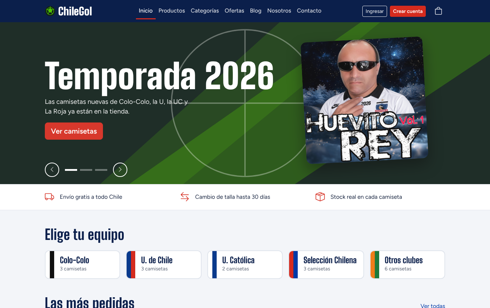

# ChileGol Store 2.0

Tienda online de camisetas de fútbol chileno (Colo-Colo, U. de Chile, U. Católica, la Selección y otros clubes), hecha con **React**, **Vite** y **Bootstrap**. Incluye catálogo, categorías, ofertas, carrito, checkout con compra exitosa y fallida, panel de administración y 10 pruebas unitarias con **Jasmine y Karma**.



## Requisitos

- [Node.js](https://nodejs.org) 20.19 o superior (recomendado: la versión LTS)
- Google Chrome (para ejecutar las pruebas con Karma)

## Cómo ejecutar el proyecto

```bash
npm install      # instala las dependencias (solo la primera vez)
npm run dev      # abre la tienda en http://localhost:5173
```

Otros comandos:

| Comando | Qué hace |
| --- | --- |
| `npm run build` | Genera la versión final en la carpeta `dist/` |
| `npm run preview` | Muestra la versión de `dist/` en el navegador |
| `npm test` | Abre Chrome y ejecuta las 10 pruebas (se quedan mirando cambios) |
| `npm run test:ci` | Ejecuta las pruebas una vez, sin ventana, y genera la cobertura |
| `npm run lint` | Revisa el código con oxlint |

Después de `npm run test:ci`, el reporte de cobertura queda en `coverage/index.html`.

## Cuentas de prueba

| Rol | Correo | Contraseña |
| --- | --- | --- |
| Administrador | admin@chilegol.cl | admin123 |
| Cliente | cliente@chilegol.cl | cliente123 |

En la página de login hay botones que completan estas cuentas automáticamente. El panel de administración está en `/admin`.

Para probar la **compra fallida**, marca "Simular rechazo del banco" en el checkout.

## Páginas

| Ruta | Página |
| --- | --- |
| `/` | Inicio (carrusel, categorías, destacados y ofertas) |
| `/productos` | Catálogo con buscador, filtro y orden |
| `/productos/:id` | Detalle de una camiseta con selector de talla |
| `/categorias` | Productos por categoría |
| `/ofertas` | Productos en oferta |
| `/carrito` | Carrito de compras |
| `/checkout` | Datos del cliente, dirección y pago |
| `/compra-exitosa` y `/compra-fallida` | Resultado de la compra |
| `/login` y `/registro` | Cuenta de usuario |
| `/nosotros`, `/contacto`, `/blogs`, `/blogs/:id` | Páginas informativas |
| `/admin/...` | Panel: dashboard, productos, categorías, órdenes, usuarios, reportes y perfil |

## Estructura

```
chilegol-store/
├── public/images/        Logo, portada y fotos de camisetas (de la v1) e ilustraciones SVG
├── src/
│   ├── components/       Piezas reutilizables: Navbar, Footer, ProductCard, ProductList, CartItem...
│   ├── context/          Estado compartido: carrito, sesión y datos de la tienda
│   ├── data/             "Base de datos" simulada: productos, categorías, usuarios, órdenes, regiones, blogs
│   ├── pages/            Una página por ruta (y pages/admin para el panel)
│   ├── services/         CRUD de productos, categorías, usuarios y órdenes + simulación de pago
│   ├── styles/           Estilos propios sobre Bootstrap
│   ├── utils/            Formato de precios, cálculos del carrito y validaciones
│   ├── App.jsx           Rutas y contextos
│   └── main.jsx          Punto de entrada
├── tests/                10 pruebas unitarias, mocks y ayudas
├── docs/                 ERS V2, cobertura del testing, guía de presentación y capturas
└── karma.conf.js         Configuración de Karma
```

## Datos y persistencia

Los datos parten de los archivos de `src/data/`. Los cambios que se hacen en el panel de administración (crear, editar o eliminar productos, órdenes nuevas, usuarios registrados) se guardan en el `localStorage` del navegador, así que se mantienen al recargar la página. En **Admin > Perfil > Restablecer datos de ejemplo** se vuelve a los datos originales.

## Documentos de entrega

- [ERS V2: Especificación de requisitos](docs/ERS_V2.md)
- [Cobertura del testing](docs/Cobertura_Testing.md)
- [Guía para la presentación](docs/Guia_Presentacion.md)
- [Plan del sprint con avance](docs/Sprint.md)

## Tecnologías

React 19, React Router 7, Vite 8, Bootstrap 5.3, Bootstrap Icons, Jasmine 4, Karma 6, Testing Library, Webpack y Babel (solo para las pruebas), Istanbul (cobertura).

---

Proyecto académico. Las fotos de las camisetas, el logo y la portada vienen de la versión 1 de la tienda; las camisetas sin foto usan ilustraciones SVG. Los nombres, escudos y marcas de clubes se usan solo como ejemplo de catálogo.
