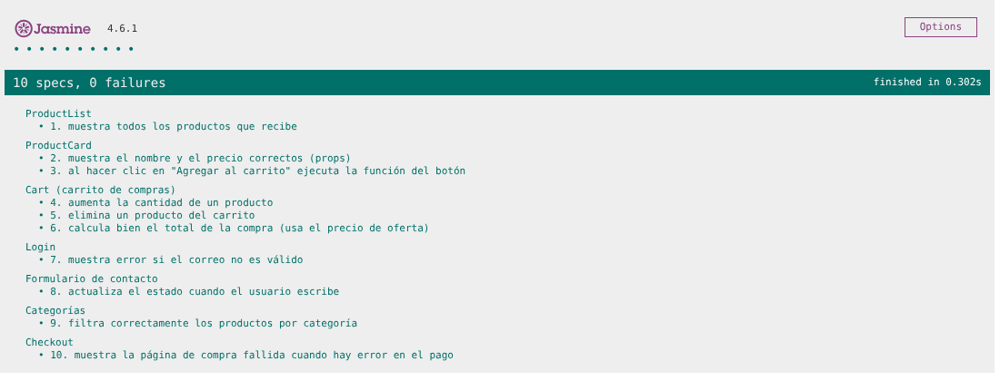
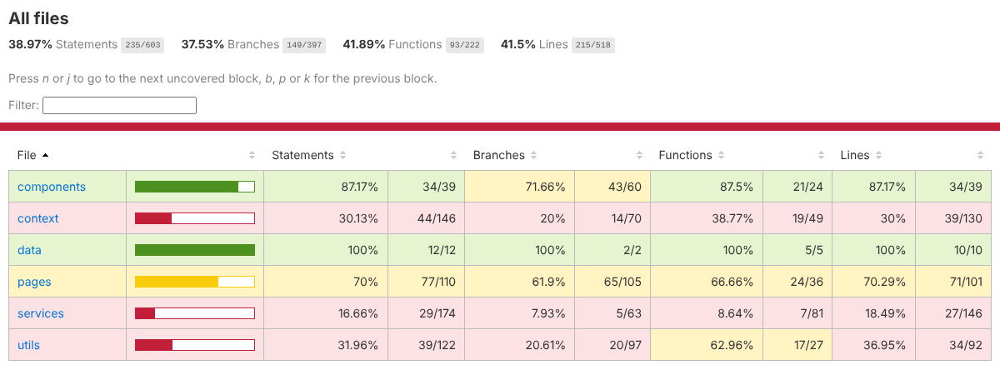

# Cobertura del Testing

**Proyecto:** ChileGol Store 2.0
**Herramientas:** Jasmine 4.6, Karma 6.4, Testing Library, karma-coverage (Istanbul)
**Fecha de ejecución:** 14 de octubre de 2026
**Resultado:** 10 de 10 pruebas aprobadas

---

## 1. Objetivo del testing

Comprobar de forma automática que las partes más importantes de la tienda funcionan como se espera: que los componentes muestran los datos que reciben por props, que reaccionan a las acciones del usuario, que el carrito calcula bien y que los errores (correo inválido, pago rechazado) se muestran correctamente.

Las pruebas también sirven como red de seguridad: si un cambio futuro rompe algo, la prueba correspondiente falla y avisa.

---

## 2. Alcance

Se probaron 7 componentes o páginas con 10 pruebas unitarias:

- Componentes reutilizables: `ProductList`, `ProductCard` (y dentro de ellos `PrecioProducto` y `CartItem`).
- Páginas con lógica: `Carrito`, `Login`, `Contacto`, `Categorias`, `Checkout` y `CompraFallida`.
- Indirectamente: los contextos `CartContext`, `AuthContext` y `TiendaContext`, las funciones de `precios.js` y `validaciones.js`.

**Fuera del alcance de estas 10 pruebas:** el panel de administración, los servicios CRUD directamente, la navegación completa y el diseño visual. Estas partes se revisaron con pruebas manuales en el navegador (sección 9).

---

## 3. Herramientas utilizadas

| Herramienta | Para qué se usa |
| --- | --- |
| **Jasmine** | Framework para escribir las pruebas: `describe` agrupa, `it` define una prueba y `expect` comprueba un resultado. También da los *spies* (`jasmine.createSpy`). |
| **Karma** | Ejecuta las pruebas en un navegador Chrome real y muestra los resultados en la terminal y en el navegador. |
| **karma-webpack + Babel** | Traducen el JSX de React para que Chrome lo entienda durante las pruebas. |
| **Testing Library (`@testing-library/react`)** | Dibuja los componentes y permite buscarlos como lo haría un usuario (por texto, por etiqueta, por rol) y simular clics y escritura (`fireEvent`). |
| **karma-coverage (Istanbul)** | Mide qué porcentaje del código de `src/` se ejecutó durante las pruebas. |
| **karma-spec-reporter / karma-jasmine-html-reporter** | Muestran el nombre de cada prueba en la terminal y en Chrome. |

---

## 4. Configuración de Jasmine y Karma

### 4.1 Instalación

```bash
npm install --save-dev jasmine-core@4 karma karma-chrome-launcher karma-jasmine karma-jasmine-html-reporter karma-spec-reporter karma-coverage
npm install --save-dev karma-webpack webpack babel-loader @babel/core @babel/preset-env @babel/preset-react babel-plugin-istanbul
npm install --save-dev @testing-library/react @testing-library/dom
```

### 4.2 Archivo `karma.conf.js` (lo principal)

```javascript
frameworks: ['jasmine', 'webpack'],
files: [ 'tests/ProductList.spec.js', 'tests/ProductCard.spec.js', ... ],   // en orden 1 a 10
preprocessors: { 'tests/**/*.spec.js': ['webpack'] },
webpack: {
  // babel-loader con preset-env + preset-react, y babel-plugin-istanbul para medir cobertura
},
reporters: ['spec', 'kjhtml', 'coverage'],
coverageReporter: { dir: 'coverage', reporters: [{ type: 'html' }, { type: 'text-summary' }] },
browsers: ['Chrome'],
customLaunchers: { ChromeHeadlessSinCaja: { base: 'ChromeHeadless', flags: ['--no-sandbox'] } },
```

### 4.3 Cómo se ejecutan

```bash
npm test          # abre Chrome, muestra los resultados y vuelve a correr si cambia un archivo
npm run test:ci   # corre una sola vez, sin ventana, y deja el reporte en coverage/index.html
```

### 4.4 Estructura de la carpeta `tests/`

```
tests/
├── ProductList.spec.js   prueba 1
├── ProductCard.spec.js   pruebas 2 y 3
├── Cart.spec.js          pruebas 4, 5 y 6
├── Login.spec.js         prueba 7
├── Formulario.spec.js    prueba 8
├── Categorias.spec.js    prueba 9
├── Checkout.spec.js      prueba 10
├── mocks/datos.js        productos, categorías, carrito y respuesta de pago falsos
└── helpers/renderizar.jsx  dibuja un componente con router, sesión, tienda y carrito de prueba
```

---

## 5. Componentes sometidos a prueba

| Componente | Archivo | Qué se revisa |
| --- | --- | --- |
| `ProductList` | `src/components/ProductList.jsx` | Que dibuje una tarjeta por producto. |
| `ProductCard` | `src/components/ProductCard.jsx` | Que muestre las props y llame a `onAgregar`. |
| `Carrito` + `CartItem` + `CartContext` | `src/pages/Carrito.jsx` | Aumentar, eliminar y calcular el total. |
| `Login` | `src/pages/Login.jsx` | Validación del correo. |
| `Contacto` | `src/pages/Contacto.jsx` | Que el estado del formulario cambie al escribir. |
| `Categorias` | `src/pages/Categorias.jsx` | Filtro por categoría. |
| `Checkout` + `CompraFallida` | `src/pages/Checkout.jsx` | Que un pago rechazado lleve a la página de compra fallida. |

---

## 6. Tabla de casos de prueba

| N.º | Componente | Qué comprueba | Datos de entrada | Resultado esperado | Resultado |
| --- | --- | --- | --- | --- | --- |
| 1 | ProductList | Muestra todos los productos que recibe | 3 productos mock | 3 tarjetas (`article`) con los 3 nombres | ✅ Aprobada |
| 2 | ProductCard | Muestra el nombre y precio correctos (props) | Producto mock de $52.990 | Se ve "Camiseta Mock Local" y "$52.990" | ✅ Aprobada |
| 3 | ProductCard | Al hacer clic en "Agregar" ejecuta la función del botón | Spy `onAgregar` | El spy se llama 1 vez con el producto | ✅ Aprobada |
| 4 | Cart | Aumenta la cantidad de un producto | Carrito mock, clic en "+" | La cantidad pasa de 1 a 2 | ✅ Aprobada |
| 5 | Cart | Elimina un producto del carrito | Clic en "Quitar" | El producto desaparece y el otro sigue | ✅ Aprobada |
| 6 | Cart | Calcula bien el total de la compra | 1 × $40.000 (oferta) + 2 × $52.990 | Total "$145.980" | ✅ Aprobada |
| 7 | Login | Muestra error si el correo no es válido | Correo "correo-sin-arroba", clave "123456" | Aparece "Ingresa un correo válido..." y no el error de contraseña | ✅ Aprobada |
| 8 | Formulario | Actualiza el estado cuando el usuario escribe | Escribir "Hola ChileGol" en Mensaje | El textarea tiene el texto y el contador pasa de 0/500 a 13/500 | ✅ Aprobada |
| 9 | Categorías | Filtra correctamente por categoría | Clic en "Mock FC" | Se ven 2 tarjetas, todas de "Mock FC" | ✅ Aprobada |
| 10 | Checkout | Muestra la compra fallida cuando hay error | Formulario completo + pago mock rechazado | Aparece "No se pudo completar la compra" con el motivo; el mock recibió total 145980 | ✅ Aprobada |

Ejemplo de una prueba (prueba 3):

```javascript
it('3. al hacer clic en "Agregar al carrito" ejecuta la función del botón', () => {
  const onAgregar = jasmine.createSpy('onAgregar');
  render(<MemoryRouter><ProductCard producto={producto} onAgregar={onAgregar} /></MemoryRouter>);

  fireEvent.click(screen.getByRole('button', { name: 'Agregar al carrito' }));

  expect(onAgregar).toHaveBeenCalledTimes(1);
  expect(onAgregar).toHaveBeenCalledWith(producto);
});
```

---

## 7. Mocks utilizados

Un mock es un dato o una función falsa que se usa solo en las pruebas para no depender de los datos reales de la tienda. Están en `tests/mocks/datos.js`.

| Mock | Qué reemplaza | Dónde se usa |
| --- | --- | --- |
| `mockProductos` (3 camisetas: una en oferta, una normal y una de otra categoría) | Los 17 productos reales de `src/data/productos.js` | Pruebas 1, 2, 3, 9 y 10 |
| `mockCategorias` ("Mock FC" y "Deportes Mock") | Las categorías reales | Pruebas 9 y 10 |
| `crearCarritoMock()` (2 artículos, total $145.980) | El carrito guardado en el navegador | Pruebas 4, 5, 6 y 10 |
| `mockPagoRechazado` | La respuesta del servicio de pago | Prueba 10 |
| `jasmine.createSpy('onAgregar')` | La función que agrega al carrito | Prueba 3 |
| `jasmine.createSpy('procesarPago')` | El servicio de pago real (`pagoService.js`), que tarda 0,9 s | Prueba 10 |

**¿Cómo llegan los mocks a los componentes?**

- Por **props**: `ProductCard` y `ProductList` reciben el producto mock y el spy directamente. `Checkout` recibe el pago mock en la prop `procesarPago`.
- Por **contexto**: `TiendaProvider`, `CartProvider` y `AuthProvider` aceptan datos iniciales (`productosIniciales`, `itemsIniciales`, `usuarioInicial`). La ayuda `tests/helpers/renderizar.jsx` los usa para dibujar cada página con datos de prueba.

Gracias a esto, si mañana se cambia un precio en la tienda, las pruebas siguen pasando porque no dependen de esos datos.

---

## 8. Resultados de ejecución

### 8.1 Terminal (`npm run test:ci`)

```
  ProductList
    ✓ 1. muestra todos los productos que recibe
  ProductCard
    ✓ 2. muestra el nombre y el precio correctos (props)
    ✓ 3. al hacer clic en "Agregar al carrito" ejecuta la función del botón
  Cart (carrito de compras)
    ✓ 4. aumenta la cantidad de un producto
    ✓ 5. elimina un producto del carrito
    ✓ 6. calcula bien el total de la compra (usa el precio de oferta)
  Login
    ✓ 7. muestra error si el correo no es válido
  Formulario de contacto
    ✓ 8. actualiza el estado cuando el usuario escribe
  Categorías
    ✓ 9. filtra correctamente los productos por categoría
  Checkout
    ✓ 10. muestra la página de compra fallida cuando hay error en el pago

Chrome Headless 141.0.0.0 (Linux): Executed 10 of 10 SUCCESS (0.265 secs / 0.222 secs)
TOTAL: 10 SUCCESS

=============================== Coverage summary ===============================
Statements   : 38.97% ( 235/603 )
Branches     : 37.53% ( 149/397 )
Functions    : 41.89% ( 93/222 )
Lines        : 41.5% ( 215/518 )
================================================================================
```

### 8.2 Navegador (reporte de Jasmine en Karma)



### 8.3 Reporte de cobertura (`coverage/index.html`)



---

## 9. Cobertura de funcionalidades

### 9.1 Cobertura de código (medida por Istanbul)

Istanbul mide solo los archivos que las pruebas cargan. Estos son los resultados por carpeta:

| Carpeta | Instrucciones | Ramas | Funciones | Líneas |
| --- | --- | --- | --- | --- |
| `components/` | 87,2 % | 71,7 % | 87,5 % | 87,2 % |
| `pages/` | 70,0 % | 61,9 % | 66,7 % | 70,3 % |
| `data/` | 100 % | 100 % | 100 % | 100 % |
| `utils/` | 32,0 % | 20,6 % | 63,0 % | 37,0 % |
| `context/` | 30,1 % | 20,0 % | 38,8 % | 30,0 % |
| `services/` | 16,7 % | 7,9 % | 8,6 % | 18,5 % |
| **Total** | **39,0 %** | **37,5 %** | **41,9 %** | **41,5 %** |

Archivos con mayor cobertura de líneas: `ProductCard.jsx` (100 %), `PrecioProducto.jsx` (100 %), `ResumenPedido.jsx` (100 %), `Categorias.jsx` (91,7 %), `Checkout.jsx` (82,9 %), `CartItem.jsx` (80 %).

**Análisis:** los componentes visuales que se usan en toda la tienda (tarjetas, listas, precios, carrito) tienen una cobertura alta, que es donde se concentraron las 10 pruebas. La cobertura total baja porque los contextos y servicios incluyen funciones del panel de administración (crear, editar y eliminar productos, categorías, órdenes y usuarios) que estas pruebas no ejecutan. Por ejemplo, `TiendaContext.jsx` tiene 15 % de líneas cubiertas: se prueba la lectura de productos, pero no el CRUD del admin. Las páginas del panel de administración no aparecen en el reporte porque ninguna prueba las carga.

### 9.2 Cobertura de funcionalidades (requisitos del ERS)

| Funcionalidad | Prueba automática | Prueba manual |
| --- | --- | --- |
| Mostrar productos (RF-01) | 1, 2 | ✅ |
| Agregar al carrito (RF-10) | 3 | ✅ |
| Cambiar cantidad y eliminar (RF-13) | 4, 5 | ✅ |
| Total con ofertas (RF-15) | 6 | ✅ |
| Validación de login (RF-26) | 7 | ✅ |
| Formulario de contacto (RF-30) | 8 | ✅ |
| Filtro por categoría (RF-07) | 9 | ✅ |
| Compra fallida (RF-23) | 10 | ✅ |
| Compra exitosa (RF-22) | - | ✅ |
| Autocompletado en checkout (RF-20) | - | ✅ |
| Buscador y orden del catálogo (RF-02, RF-03) | - | ✅ |
| Registro y cierre de sesión (RF-25, RF-28) | - | ✅ |
| Panel admin: CRUD, órdenes, usuarios, reportes, perfil (RF-33 a RF-45) | - | ✅ |
| Diseño responsivo (RNF-01) | - | ✅ (Chrome en 390, 820 y 1366 px de ancho) |

Las 8 funcionalidades principales de la compra tienen prueba automática. El resto se verificó a mano siguiendo cada flujo en el navegador.

---

## 10. Problemas detectados

| N.º | Problema | Cómo se detectó |
| --- | --- | --- |
| P1 | Webpack no encontraba los archivos importados sin extensión (`Cannot find module '../src/components/ProductCard'`). | Primera ejecución de Karma: 0 pruebas ejecutadas. |
| P2 | `karma-jasmine` trae internamente Jasmine 4, pero npm instaló Jasmine 7 para el reporte HTML, quedando dos versiones distintas. | Revisión de dependencias con `npm ls jasmine-core`. |
| P3 | Las pruebas del carrito podían verse afectadas por lo que quedaba guardado en `localStorage` de una prueba anterior. | Revisión del diseño de las pruebas. |
| P4 | El servicio de pago real tarda 0,9 s y aprueba casi siempre, lo que hacía la prueba 10 lenta y difícil de forzar a fallar. | Diseño de la prueba 10. |
| P5 | Karma ejecutaba los archivos en orden alfabético (4, 5, 6, 9, 10, 8, 7, 2, 3, 1), confuso para la demostración. | Salida de la terminal. |
| P6 | Al cerrar sesión desde el panel de administración, la tienda llevaba al login en vez de al inicio. | Prueba manual del panel. |

---

## 11. Correcciones realizadas

| N.º | Corrección |
| --- | --- |
| P1 | Como el proyecto usa `"type": "module"`, Webpack exige escribir la extensión. Se agregó en `karma.conf.js` la regla `resolve: { fullySpecified: false }`. |
| P2 | Se fijó `jasmine-core@4.6.1`, la misma versión que usa `karma-jasmine`. |
| P3 | Cada prueba que usa el carrito limpia `localStorage` en `beforeEach` y recibe un carrito nuevo con `crearCarritoMock()`. Los contextos aceptan datos iniciales para usar mocks. |
| P4 | `Checkout` recibe el servicio de pago como prop (`procesarPago`). En la prueba se reemplaza por un spy de Jasmine que responde "rechazado" al instante. |
| P5 | En `karma.conf.js` se listaron los archivos de prueba en el orden de la tabla de casos. |
| P6 | La ruta protegida veía "sin sesión" antes del cambio de página y redirigía al login. Se usó `startTransition` para que cerrar sesión y navegar ocurran juntos. |

---

## 12. Conclusiones del testing

- Las **10 pruebas unitarias pasan** en Chrome en menos de medio segundo.
- Se probaron los dos conceptos principales de React: **props** (pruebas 1, 2 y 3) y **estado** (pruebas 4, 5, 8 y 9), además de validaciones (7), cálculos (6) y manejo de errores (10).
- Los **mocks y spies** permitieron probar cada componente de forma aislada, sin depender de los datos reales ni del tiempo de respuesta del pago.
- Los componentes reutilizables tienen **87 % de cobertura**. La cobertura total (41,5 % de líneas) refleja que el panel de administración y los servicios se probaron solo manualmente.
- **Próximos pasos** para subir la cobertura: pruebas directas de `productosService.js` (crear, actualizar, eliminar), de `validaciones.js` (todas las reglas), del `carritoReducer` y del formulario de productos del panel.
