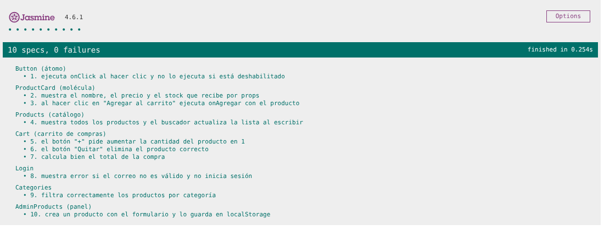
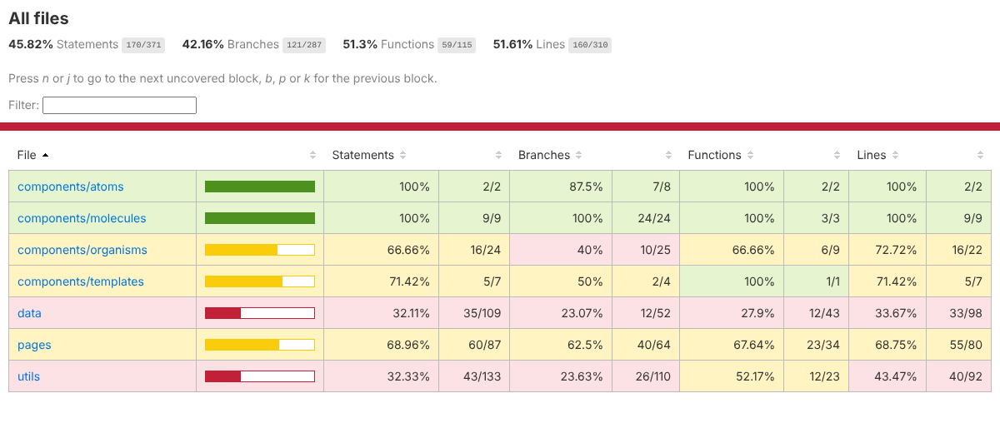

# Cobertura del Testing

**Proyecto:** ChileGol Store 2.0 (React)
**Herramientas:** Jasmine 4.6, Karma 6.4, Testing Library, karma-coverage (Istanbul)
**Resultado:** 10 de 10 pruebas aprobadas

---

## 1. Objetivo del testing

Comprobar automáticamente que las partes principales de la tienda funcionan: que los componentes muestran lo que reciben por props, que reaccionan a lo que hace el usuario, que el carrito calcula bien, que los formularios rechazan datos inválidos y que el panel guarda los cambios en localStorage.

## 2. Alcance

Se probaron 7 componentes o páginas, uno de cada nivel de Atomic Design:

| Nivel | Componente | Pruebas |
| --- | --- | --- |
| Átomo | `Button` | 1 |
| Molécula | `ProductCard` | 2 y 3 |
| Página | `Products`, `Cart`, `Login`, `Categories` | 4 a 9 |
| Página + plantilla | `AdminProducts` dentro de `AdminLayout` | 10 |

De forma indirecta también se recorren `Input`, `FormGroup`, `ProductForm`, `AdminSidebar`, `data/products.js`, `data/storage.js` y `utils/validaciones.js`.

Fuera de estas 10 pruebas quedaron `Register`, `Contact`, `AdminUsers`, `AdminDashboard`, `Checkout` y `ProductDetail`. Se revisaron a mano en el navegador (sección 9.2).

## 3. Herramientas utilizadas

| Herramienta | Para qué se usa |
| --- | --- |
| Jasmine | Escribir las pruebas: `describe` agrupa, `it` define una prueba, `expect` comprueba un resultado y `jasmine.createSpy` crea funciones falsas. |
| Karma | Ejecutar las pruebas dentro de Chrome y mostrar los resultados. |
| karma-webpack + Babel | Traducir el JSX de React para que Chrome lo entienda. |
| Testing Library | Dibujar los componentes, buscarlos como lo haría un usuario (por texto, etiqueta o rol) y simular clics y escritura con `fireEvent`. |
| karma-coverage (Istanbul) | Medir qué porcentaje del código de `src/` se ejecutó. |
| karma-spec-reporter y karma-jasmine-html-reporter | Mostrar el nombre de cada prueba en la terminal y en Chrome. |

## 4. Configuración de Jasmine y Karma

Instalación:

```bash
npm install --save-dev jasmine-core@4 karma karma-chrome-launcher karma-jasmine karma-jasmine-html-reporter karma-spec-reporter karma-coverage
npm install --save-dev karma-webpack webpack babel-loader @babel/core @babel/preset-env @babel/preset-react babel-plugin-istanbul
npm install --save-dev @testing-library/react @testing-library/dom
```

Lo principal de `karma.conf.cjs`:

```javascript
frameworks: ['jasmine', 'webpack'],
files: ['src/test/setupTests.js', 'src/test/atoms/Button.spec.js', /* ... en orden de 1 a 10 */],
preprocessors: { 'src/test/**/*.js': ['webpack'] },
webpack: {
  // babel-loader con preset-env y preset-react, más babel-plugin-istanbul para la cobertura.
  // Los .css se cargan como texto y las imágenes como data URL, porque las pruebas no los necesitan.
},
reporters: ['spec', 'kjhtml', 'coverage'],
browsers: ['Chrome'],
customLaunchers: { ChromeSinVentana: { base: 'ChromeHeadless', flags: ['--no-sandbox'] } },
```

`src/test/setupTests.js` se carga primero y limpia el `localStorage` antes de cada prueba, para que ninguna dependa de lo que dejó la anterior.

Ejecución:

```bash
npm test          # Chrome visible, vuelve a correr al guardar un archivo
npm run test:ci   # una vez, sin ventana, con reporte en coverage/index.html
```

Estructura:

```
src/test/
├── setupTests.js
├── mocks/datos.js              productos, carrito y sesión de prueba
├── atoms/Button.spec.js        prueba 1
├── molecules/ProductCard.spec.js  pruebas 2 y 3
└── pages/
    ├── Products.spec.js        prueba 4
    ├── Cart.spec.js            pruebas 5, 6 y 7
    ├── Login.spec.js           prueba 8
    ├── Categories.spec.js      prueba 9
    └── AdminProducts.spec.js   prueba 10
```

## 5. Componentes sometidos a prueba

| Componente | Archivo | Qué se revisa |
| --- | --- | --- |
| Button | `components/atoms/Button.jsx` | Evento `onClick` y estado deshabilitado |
| ProductCard | `components/molecules/ProductCard.jsx` | Props (nombre, precio, stock) y evento de agregar |
| Products | `pages/Products.jsx` | Lista completa y estado del buscador |
| Cart | `pages/Cart.jsx` | Botones +, Quitar y cálculo del total |
| Login | `pages/Login.jsx` | Validación del correo con react-hook-form |
| Categories | `pages/Categories.jsx` | Filtro por categoría |
| AdminProducts | `pages/AdminProducts.jsx` | Crear un producto (CRUD) y guardarlo en localStorage |

## 6. Tabla de casos de prueba

| N.º | Componente | Qué comprueba | Datos de entrada | Resultado esperado | Resultado |
| --- | --- | --- | --- | --- | --- |
| 1 | Button | Ejecuta `onClick` y no lo hace si está deshabilitado | Spy, clic normal y clic con `disabled` | El spy se llama 1 vez en total | ✅ |
| 2 | ProductCard | Muestra los datos recibidos por props | Producto mock de $49.990 y stock 10 | Se ven el nombre, "$49.990" y "Stock: 10" | ✅ |
| 3 | ProductCard | "Agregar al carrito" ejecuta `onAgregar` | Spy `onAgregar` | Se llama 1 vez con el producto | ✅ |
| 4 | Products | Muestra todo y el buscador filtra | 3 productos mock, escribir "wanderers" | 3 tarjetas al inicio; 1 al buscar | ✅ |
| 5 | Cart | "+" pide aumentar la cantidad | Carrito mock, producto 1 con cantidad 2 | `onCambiarCantidad(1, 3)` | ✅ |
| 6 | Cart | "Quitar" elimina el producto correcto | Clic en "Quitar" del producto 2 | `onEliminar(2)` | ✅ |
| 7 | Cart | Calcula el total | 2 × $49.990 + 1 × $39.990 | Total "$139.970" y subtotal "$99.980" | ✅ |
| 8 | Login | Error si el correo no es válido | `hincha@hotmail.com` y clave `1234` | Aparece el error de dominio, el campo queda `aria-invalid` y no se inicia sesión | ✅ |
| 9 | Categories | Filtra por categoría | Clic en "Shorts" y luego en "Camisetas" | 1 tarjeta y luego 2, todas de esa categoría | ✅ |
| 10 | AdminProducts | Crea un producto y lo guarda | Sesión de administrador mock, formulario con código `mock-04` | Aviso "Producto creado", fila con código `MOCK-04`, 4 productos en localStorage con id 4 y aviso a la tienda | ✅ |

Ejemplo (prueba 8):

```javascript
it('8. muestra error si el correo no es válido y no inicia sesión', async () => {
  const onLogin = jasmine.createSpy('onLogin');
  render(<MemoryRouter><Login onLogin={onLogin} /></MemoryRouter>);

  fireEvent.change(screen.getByLabelText('Correo'), { target: { value: 'hincha@hotmail.com' } });
  fireEvent.change(screen.getByLabelText('Contraseña'), { target: { value: '1234' } });
  fireEvent.click(screen.getByRole('button', { name: 'Iniciar sesión' }));

  // react-hook-form valida de forma asíncrona: findByText espera a que aparezca el error
  expect(await screen.findByText('Usa un correo terminado en @duoc.cl, @profesor.duoc.cl y @gmail.com.')).toBeTruthy();
  expect(onLogin).not.toHaveBeenCalled();
});
```

## 7. Mocks utilizados

Un mock es un dato o una función falsa que se usa solo en las pruebas. Están en `src/test/mocks/datos.js`.

| Mock | Qué reemplaza | Pruebas |
| --- | --- | --- |
| `mockProductos`: 3 productos en 2 categorías (uno agotado) | Los productos reales de `data/products.js` | 2, 3, 4, 9 y 10 |
| `crearCarritoMock()`: 2 artículos, total $139.970 | El carrito guardado en el navegador | 5, 6 y 7 |
| `mockSesionAdmin` | La sesión de un administrador conectado | 10 |
| `localStorage` con `mockProductos` | La base de datos simulada | 10 |
| `jasmine.createSpy(...)` | Las funciones `onClick`, `onAgregar`, `onCambiarCantidad`, `onEliminar`, `onLogin` y `onProductosCambiados` | 1, 3, 5, 6, 8 y 10 |

Los mocks llegan a los componentes por **props** (como en la tienda, `App.jsx` pasa los productos y las funciones del carrito por props) y por el `localStorage`, que se prepara antes de dibujar el panel.

## 8. Resultados de ejecución

Terminal (`npm run test:ci`):

```
  Button (átomo)
    ✓ 1. ejecuta onClick al hacer clic y no lo ejecuta si está deshabilitado
  ProductCard (molécula)
    ✓ 2. muestra el nombre, el precio y el stock que recibe por props
    ✓ 3. al hacer clic en "Agregar al carrito" ejecuta onAgregar con el producto
  Products (catálogo)
    ✓ 4. muestra todos los productos y el buscador actualiza la lista al escribir
  Cart (carrito de compras)
    ✓ 5. el botón "+" pide aumentar la cantidad del producto en 1
    ✓ 6. el botón "Quitar" elimina el producto correcto
    ✓ 7. calcula bien el total de la compra
  Login
    ✓ 8. muestra error si el correo no es válido y no inicia sesión
  Categories
    ✓ 9. filtra correctamente los productos por categoría
  AdminProducts (panel)
    ✓ 10. crea un producto con el formulario y lo guarda en localStorage

Chrome Headless 141.0.0.0 (Linux): Executed 10 of 10 SUCCESS (0.225 secs / 0.198 secs)
TOTAL: 10 SUCCESS

Statements   : 45.82% ( 170/371 )
Branches     : 42.16% ( 121/287 )
Functions    : 51.3% ( 59/115 )
Lines        : 51.61% ( 160/310 )
```

Navegador (reporte de Jasmine en Karma):



Reporte de cobertura (`coverage/index.html`):



## 9. Cobertura de funcionalidades

### 9.1 Cobertura de código

| Carpeta | Instrucciones | Ramas | Funciones | Líneas |
| --- | --- | --- | --- | --- |
| `components/atoms` | 100 % | 87,5 % | 100 % | 100 % |
| `components/molecules` | 100 % | 100 % | 100 % | 100 % |
| `components/organisms` | 66,7 % | 40,0 % | 66,7 % | 72,7 % |
| `components/templates` | 71,4 % | 50,0 % | 100 % | 71,4 % |
| `pages` | 69,0 % | 62,5 % | 67,6 % | 68,8 % |
| `utils` | 32,3 % | 23,6 % | 52,2 % | 43,5 % |
| `data` | 32,1 % | 23,1 % | 27,9 % | 33,7 % |
| **Total** | **45,8 %** | **42,2 %** | **51,3 %** | **51,6 %** |

Archivos con 100 % de líneas: `Button`, `Input`, `FormGroup`, `ProductCard`, `Products`, `Categories` y `formato.js`.

**Análisis:** los átomos y moléculas, que se reutilizan en toda la tienda, quedaron cubiertos por completo. La cobertura total baja por `data/users.js` (13 %) y `utils/validaciones.js` (43 %): las pruebas no pasan por el registro, la gestión de usuarios ni las reglas del RUN. Istanbul solo mide los archivos que alguna prueba carga, por eso `Register`, `Contact`, `AdminUsers` y `AdminDashboard` no aparecen en el reporte.

### 9.2 Cobertura de funcionalidades

| Funcionalidad | Prueba automática | Prueba manual en el navegador |
| --- | --- | --- |
| Mostrar productos y buscador | 2, 4 | ✅ |
| Agregar al carrito | 3 | ✅ |
| Cambiar cantidad, quitar y total | 5, 6, 7 | ✅ |
| Login con validación | 8 | ✅ (correo, clave, credenciales incorrectas, redirección por rol) |
| Filtro por categoría | 9 | ✅ |
| CRUD de productos | 10 (crear) | ✅ (crear, editar, eliminar, código repetido, stock crítico) |
| Registro con RUN, región y comuna | - | ✅ |
| Contacto con contador de caracteres | - | ✅ |
| CRUD de usuarios y permisos por rol | - | ✅ (Administrador, Vendedor y Cliente) |
| Diseño responsivo del panel y formularios | - | ✅ (Chrome a 390 y 1366 px de ancho) |

Para comprobar que las pruebas detectan errores de verdad, se cambió el código a propósito: al calcular el total sin multiplicar por la cantidad falló la prueba 7, y al aceptar correos `@hotmail.com` falló la prueba 8. Después se restauró el código.

## 10. Problemas detectados

| N.º | Problema |
| --- | --- |
| P1 | Webpack no resolvía los imports sin extensión (`../pages/Cart`) porque el proyecto usa `"type": "module"`. |
| P2 | Los componentes importan `.css` y `.svg`, y Webpack no sabía cargarlos durante las pruebas. |
| P3 | `karma-jasmine` usa Jasmine 4 y npm instalaba Jasmine 7 para el reporte HTML: quedaban dos versiones. |
| P4 | Karma ejecutaba los archivos en orden alfabético, distinto a la tabla de casos. |
| P5 | En el celular, la tabla del panel ensanchaba la página: los textos ocultos para lectores de pantalla (`position: absolute`) se salían del contenedor con scroll. |
| P6 | El formulario de producto seguía mostrando el error de código repetido después de corregirlo. |
| P7 | Al cerrar sesión desde el panel, la ruta protegida alcanzaba a ver "sin sesión" y mandaba al login en vez de a la tienda. |

## 11. Correcciones realizadas

| N.º | Corrección |
| --- | --- |
| P1 | Regla `resolve: { fullySpecified: false }` en la configuración de Webpack de `karma.conf.cjs`. |
| P2 | Los `.css` se cargan como texto (`asset/source`) y las imágenes como data URL (`asset/inline`). |
| P3 | Se fijó `jasmine-core@4.6.1`, la misma versión que usa `karma-jasmine`. |
| P4 | Los archivos se listan en `karma.conf.cjs` en el orden de la tabla, y `random: false` en Jasmine. |
| P5 | `.tabla-envoltorio { position: relative; }` y `min-width: 0` en el área de trabajo del panel. |
| P6 | El aviso de error se limpia cada vez que se vuelve a enviar el formulario. |
| P7 | Cerrar sesión y navegar se hacen dentro de `startTransition`, así ocurren en el mismo cambio. |

## 12. Conclusiones

- Las **10 pruebas pasan** en Chrome en menos de medio segundo.
- Se probaron **props** (2, 3 y 7), **estado** (4 y 9), **eventos** (1, 3, 5 y 6), **validaciones con react-hook-form** (8) y **persistencia en localStorage** (10).
- Los **mocks y spies** permitieron probar cada componente sin depender de los datos reales ni de la sesión.
- Átomos y moléculas tienen **100 %** de cobertura; el total es **51,6 % de líneas**.
- **Próximos pasos** para subir la cobertura: pruebas para `Register` (RUN y región/comuna), `AdminUsers` (permisos por rol), las funciones de `validaciones.js` y una página de pago fallido cuando exista.
